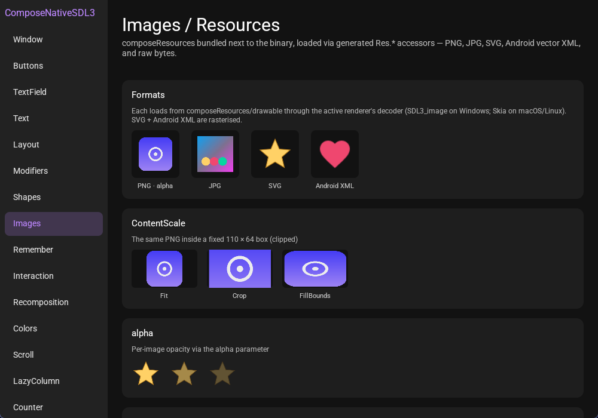
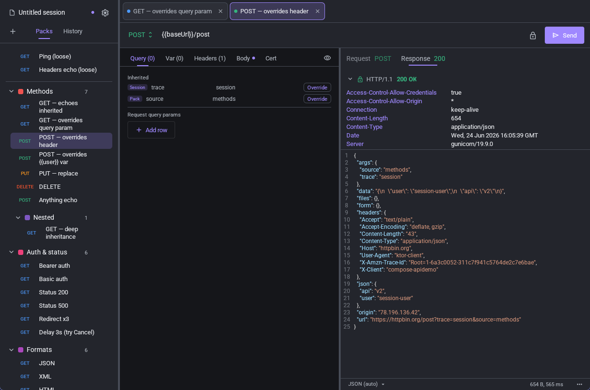

[](https://kotlinlang.org)
[](https://github.com/JetBrains/compose-multiplatform)
[](LICENSE.md)

# Compose Desktop Native

Run [Compose Multiplatform](https://github.com/JetBrains/compose-multiplatform)
as a native binary, with no JVM. One executable for macOS (arm64), Linux
(x64 / arm64) and Windows (mingwX64), rendered by Skia, with
[SDL3](https://libsdl.org) for windowing and input.



| Platform | Gradle target | Renderer |
|---|---|---|
| macOS arm64 | `macosArm64` | Skia / Metal (official Skiko) |
| Linux x64 / arm64 | `linuxX64` / `linuxArm64` | Skia / OpenGL (official Skiko) |
| Windows x64 | `mingwX64` | Skia / OpenGL ([bitsycore Skiko fork](https://maven.bitsycore.com/releases)) |

A distributable is the executable plus a `data.kres` resource bundle (and
`skiko-windows-x64.dll` on Windows). SDL3 is linked in statically.

## Philosophy: stay close to upstream

This is a small project porting a very large one. It stays maintainable by
writing as little of its own code as possible:

- **The runtime is the real one.** Composition, snapshots and the recomposer
  are the official `org.jetbrains.compose.runtime` klibs, never reimplemented.
- **Vendor, don't rewrite.** `ui`, `foundation`, `animation` and `material3` are
  copied from upstream byte-for-byte by a manifest per module, not checked in.
  Upgrading means bumping a tag, re-syncing and fixing what breaks. The few
  files that need edits are tracked copies whose drift from upstream is checked
  on every bump.
- **Upstream packages hold upstream API only.** Anything the port adds lives in
  `com.compose.sdl`, so code written against `androidx.compose.*` behaves the
  same on the JVM.
- **Compose Desktop is the reference.** The sample apps also build for stock
  JVM Compose Desktop. Any difference between the two builds is a porting bug.
- **One platform layer.** OS integration goes through SDL3, not per-OS code.
- **Pin to what upstream ships.** Versions follow the Compose Multiplatform
  release; anything CMP doesn't integrate tracks its latest stable release.

For contributors, that means the best change is usually a manifest line, not
new code. The rules behind it are in [CLAUDE.md](CLAUDE.md#vendoring-philosophy---read-this-before-writing-any-androidxcompose-code).

## Quickstart

### Use it from your project

Apply the bridge plugin and keep declaring the **official** Compose
coordinates. On native desktop targets the plugin swaps in this port's klibs;
Android, JVM, iOS and web keep the official artifacts.

```kotlin
plugins {
    kotlin("multiplatform")
    id("org.jetbrains.compose")
    id("com.bitsycore.compose-desktop-native.bridge") version "<release>"
}

kotlin {
    sourceSets.commonMain.dependencies {
        // The plugin exposes the Compose versions the port tracks.
        implementation("org.jetbrains.compose.ui:ui:${composeDesktopNative.compose}")
        implementation("org.jetbrains.compose.foundation:foundation:${composeDesktopNative.compose}")
        implementation("org.jetbrains.compose.material3:material3:${composeDesktopNative.composeMaterial3}")
    }
}
```

Keep the Compose Gradle plugin on the same version as
`composeDesktopNative.compose`; an older one silently skips generating the
`Res` accessors. Artifacts are on [maven.bitsycore.com](https://maven.bitsycore.com/releases)
(public, no credentials). The repository setup and the `compose.desktop.native { }`
DSL (entry point, app icon, fonts) are in the
[plugin README](gradle-plugin/compose-desktop-native-bridge/README.md), and
[compose-desktop-native-bridge-example](https://github.com/bitsycore/compose-desktop-native-bridge-example)
is a complete Android + JVM + native project.

### Write an app

The entry point mirrors Compose Desktop's `application { Window(...) }`:

```kotlin
import com.compose.sdl.*

fun main() = nativeComposeApp {
    var showInspector by remember { mutableStateOf(false) }

    Window(
        onCloseRequest = ::exitApplication,
        title = "Main",
        state = rememberWindowState(size = DpSize(1000.dp, 700.dp)),
    ) {
        Button(onClick = { showInspector = true }) { Text("Open inspector") }
    }

    if (showInspector) {
        Window(onCloseRequest = { showInspector = false }, title = "Inspector") { /* ... */ }
    }

    Tray(icon = painterResource(Res.drawable.icon), tooltip = "My app") {
        Item("Quit", onClick = ::exitApplication)
    }
}
```

- `Window()` takes Compose Desktop's parameters (`state`, `visible`,
  `undecorated`, `transparent`, `resizable`, `alwaysOnTop`, key handlers, …).
  `WindowState` is upstream's: size, position, placement and minimized sync both
  ways with the OS.
- Each window has its own `Lifecycle`, `ViewModelStore` and
  `SavedStateRegistry`, so ViewModels and saved state work as on Android.
- `nativeComposeWindow(title = …) { }` is the single-window shortcut.
- Port-only extras live on `LocalComposeNativeWindow.current` (pixel density,
  FPS, renderer name, `raise()`) and `rawSdlHandles()` gives the raw SDL / GL /
  Metal handles when you need SDL directly.

The entry point is the one native-specific piece: everything inside `Window`
is ordinary shared Compose code.

## What's included

Beyond Compose itself, the port ships the libraries that upstream doesn't
publish for Kotlin/Native desktop, vendored unchanged and substituted by the
bridge plugin, so you still declare their official coordinates:

| Library | Why it's vendored |
|---|---|
| Compose `ui`, `foundation`, `animation`, `material3`, `material-ripple` | the port itself |
| `material3-adaptive` (all four modules) | upstream publishes apple targets only |
| `components-resources`, `navigation3-ui` | no Linux / Windows klibs upstream |
| Koin `koin-compose*` / `koin-core-viewmodel` | apple + android only upstream (`koin-core` is used as-is) |
| Coil 3 (whole stack) | no Windows klibs, no desktop-native compose layer |
| Pulse MVI | no desktop-native artifact upstream |

The androidx architecture stack (lifecycle, viewmodel, savedstate,
navigation3-runtime, navigationevent, collection, window-core) already ships
Kotlin/Native desktop klibs and is used unmodified. Use the google `androidx.*`
coordinates, not the `org.jetbrains.androidx.*` mirrors, or every class is on the
classpath twice. Koin's `koin-compose-viewmodel-navigation` is not provided (it
needs Navigation 2, which has no desktop-native klibs); use
`koin-compose-navigation3`.

## Versions

| | Version |
|---|---|
| Compose Multiplatform | 1.12.2 (material3 1.12.0-alpha03, material3-adaptive 1.3.0) |
| Kotlin | 2.4.21 |
| SDL3 | 3.4.20 |
| Skiko | 0.150.2 (Windows fork: 0.150.2-mingw.1) |
| Koin / Coil / Pulse | 4.2.2 / 3.6.3 / 0.4.1 |

Every version is pinned in [`gradle/libs.versions.toml`](gradle/libs.versions.toml),
the vendored upstream tags in [`compose.properties`](scripts/compose-fork/compose.properties)
and SDL in [`build-sdl.properties`](scripts/build-sdl/build-sdl.properties).
Release numbers are `<compose version>-<n>`, e.g. `1.12.2-4`.

## Building from source

```bash
python3 scripts/build-sdl/build-all.py          # once per machine: static SDL3
./gradlew :demo:runDebugExecutableMacosArm64    # or LinuxX64; gradlew.bat ... MingwX64 on Windows
./gradlew :demo:run                             # the same app on JVM Compose Desktop
```

Every host needs `git`, `cmake` and Python 3, plus the Xcode command line tools
(macOS), gcc and the X11 / Wayland dev headers (Linux), or a mingw-w64 g++ on
`PATH` (Windows). Windows builds must run on Windows.

The repo has two sample apps: **`:demo`**, a tour of 30+ screens of Compose and
Material 3, and **`:apidemo`**, a Postman-style REST client with mTLS and
TLS-chain inspection.



## Documentation

- [TOOLING.md](TOOLING.md): native libraries, vendor sync, verification and
  probes, the release runbook.
- [CLAUDE.md](CLAUDE.md): architecture, module layout, vendoring rules,
  source sets and common pitfalls.
- [PLAN.md](PLAN.md): known gaps and the road to 1.0.
- [Bridge plugin](gradle-plugin/compose-desktop-native-bridge/README.md):
  consuming the port from another build.

## Support

[Bitsycore's Discord](https://discord.gg/kGnraVAtDR)

## License

[MIT](LICENSE.md)
